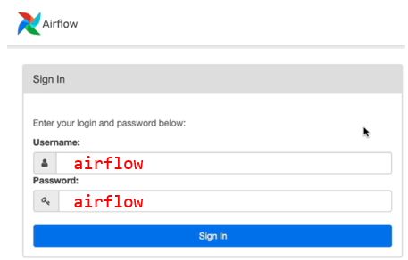

# Codespaces Airflow training environment

This repository contains the code for the Airflow training environment.

## Getting started

1. Check that you have enough memory allocated to your codespaces instance. In the terminal (ctrl + ` ) check you have more than 4GB of allocated memory:

    ```
    docker run --rm "debian:bullseye-slim" bash -c 'numfmt --to iec $(echo $(($(getconf _PHYS_PAGES) * $(getconf PAGE_SIZE))))'
    ```

    An no, 3.9 is not enough. If you see 3.9 means that you did not selected the right machine in step 2.

2. Now you can start all services:
    ```
    docker compose up
    ```

    This will make Airflow available at: http://localhost:8080


3. Login to Airflow:

    


# Running Airflow in a Python Environment
If for some reason its not possible to you to run Airflow using docker, you can also do it using python.

1. Install airflow
    ```
    pip install apache-airflow
    ```
    or
    ```
    poetry add apache-airflow
    ```

    Make sure you have a virtual environment activated in which you can isolate your code/dependencies


2. initialize the database
    ```
    airflow db init
    ```

3. Create a new user
    ```
    airflow users create --username airflow --password airflow --firstname anon --lastname nymus --role Admin --email user@company.com 
    ```

4. Copy your dags to the dags/ folder
    ```
    cp dags/mydag.py ~/airflow/dags/
    ```

5. In a termnial initialize the webserver
    ```
    airflow webserver -p 8080
    ```

6. In a second terminal initialize the scheduler
    ```
    airflow scheduler
    ```

## TODO

Add task dependency explanation to the slide deck (bitshift operator) based on https://www.astronomer.io/docs/learn/managing-dependencies
It is in slides 92 - 95 and dag dependencies in 96-99

Datasets in 100 - 103

Connections 105-110 Need to go earlier (when explaining hooks)

Architectures 111-115 can also go earlier


Building your own operator goes into catapi normal task not a build your own!

Time and scheduling 42 - 47 needs to go earlier


Time&scheduling 42-47
Best practices 48 - 61
Logging and monitoring 62- 76
Connections 104-110
Provider packages 76 - 78 (skip bonus)
Dataset 92 - 104
Architectures 111 - end
Testing 80 - 88
CICD 89 - 91
